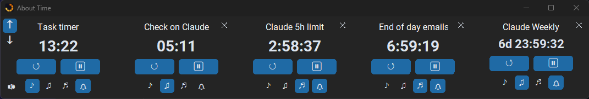
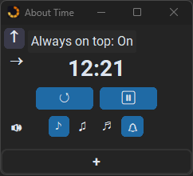
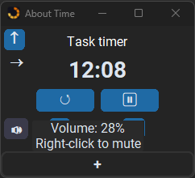
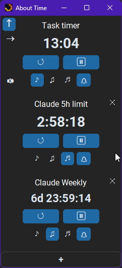

# About Time - Always-on-Top Timer App

  

> **This project is in active development.** Features and behaviour may change between releases.
>
> MIT licensed — free to use, copy, modify, and redistribute, including commercially, as long as the license text stays attached.

**A free Windows desktop timer that stays on top of everything else.**

About Time keeps your countdowns always visible, no matter what you're working on. Run up to 5 named task timers simultaneously, each with its own label and countdown, and choose from an optional set of notification sounds when each one finishes. Designed for people who are constantly needing to switch tabs (and monitors) without losing track of time left on something else.

1. [Why This Exists](#why-this-exists)
2. [Download](#download)
3. [Features](#features)
4. [Known Issues / Notes](#known-issues--notes)
5. [Tech Stack](#tech-stack)

## Why This Exists

About Time is the product of wanting a timer or reminder that was well suited to fast context switching and short duration tasks, particularly overlapping ones. Obviously I could use my phone, but the constant stop start of picking it up and putting it down was hurting my focus. Other apps I tried were either denser than I needed, or would just annoyingly disappear behind another window the moment I had to swap tasks or answer a message.

This program is a project built using Claude Code to fit that niche; a visible timer to track what's up next and how long I have left, that can stay fixed at the front of my desktop with Always-On-Top. If you're also a remote worker, you might understand the struggle keenly. When managing Claude Code replies, food cooking in another room, and an expected handle time for a work task all at once, you can't let anything slip out of your focus.

## Download

Grab the latest `.exe` from [Releases](https://github.com/Fjarun/About-Time/releases) — no install required, runs directly on Windows.

You may encounter SmartScreen warnings on first run. To work around these, choose "More info" and then "Run anyway."

## Features

- **Always-on-top toggle** — pin the window so it floats above everything else on screen.
- Run from **1 to 5 countdown timers** at once, each allowing a unique name and sound or popup notification setting.
- Custom time input per timer, supporting up to 32 days: plain number input is assumed to be minutes, otherwise you can suffix with `s`/`m`/`h`/`d` for a single unit and mix units in one go — `3h14m`, `1d2h15m`.
- Click the countdown display to edit the time at any point — even with ongoing timers. Click out again if you don't want to make any changes.
- **Windows desktop notifications** — opt-in toast alerts when a timer finishes, toggled per timer, showing that timer's name or duration if untitled.

 

### Sounds

- Three notification chimes — short, medium, and long, designed as a consistent family.
- Each timer has its own sound picker — pick short, medium, or long, or click the active one again to turn that timer's sound off.
- **Global mute** — silences every timer at once by right-clicking the volume button; per-timer sound pickers are locked while muted and no sound will play.
- **Windows Volume Mixer integration** — the volume button opens a slider that controls this app's own volume directly in Windows' native per-app mixer.

 

### Layouts

- **Layout toggle** — switch between a vertical stack and a horizontal row of timers; boxes stay a fixed size in either layout.
- Add timers one at a time via the **+** tile at the end of the stack/row; remove any individual slot with its **x** button — no need to manage a fixed set.
- To keep things simple, the window has a locked size per timer, automatically resizing as timers are added, removed or the window layout is switched.

### Persistence

- Window position, timer count, timer names and durations should all be remembered between sessions, with guards against loading known bad states such as a saved offscreen position.
- Mid-run and paused timers restore at their remaining time on reopen — ready to resume or reset, no progress lost on accidental close.
- Settings such as sound choice, always-on-top, notification toggle and more are written to `%appdata%\About Time\settings.json` - if you need the file for some reason, check appdata roaming.
- If `settings.json` ever becomes unreadable or corrupted, About Time keeps the bad file as `settings.json.bak` next to it, rather than overwriting it, and starts fresh with defaults. In the event the file cannot be interacted with at all, About Time will run without saving persistence until next restart.

 

## Known Issues / Notes

- **First launch should start at 50% volume, not system default.** This is intended, not a bug: a brand-new Windows audio session for an app defaults to 100%, and About Time's own volume uses Windows' per-app Volume Mixer. Because of this combination of settings, the first sound played might be extremely loud for users with high speaker settings. The volume is pre-lowered to soften that.
- If your settings are not being kept between sessions, the `settings.json` is likely having an issue. To resolve this, close About Time and delete the old `settings.json` from `%appdata%\About Time` to revert to defaults and have a new file created.

### Error log

If something goes wrong, About Time writes a short timestamped note to `error.log` in `%appdata%\About Time\`, the same folder as `settings.json`. It's useful to attach when reporting a bug. The log is capped at 256 KB: past that, the old one is kept as `error.log.old` and a fresh one starts.

## Tech Stack

| | |
|---|---|
| Language | Python 3.x |
| UI | customtkinter |
| Audio | winsound + struct (WAV synthesised in-memory — no audio files); pycaw for Windows Volume Mixer integration |
| Notifications | winotify (Windows toast) |
| Build | PyInstaller |
